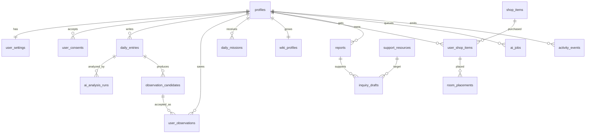

# Re:Link AI Backend and DB Architecture Plan

## 1. Product Reading

도전제안서 기준 Re:Link AI의 핵심은 진단이나 상담 자동화가 아니다. 서비스의 본질은 아래 흐름이다.

1. 사용자가 위키와 짧게 하루를 기록한다.
2. AI가 원문 근거가 있는 관찰 후보와 확인 질문을 만든다.
3. 사용자가 맞는 조각만 선택하거나 수정해서 저장한다.
4. 저장된 조각을 바탕으로 낮은 부담의 하루 부탁을 제안한다.
5. 기록과 하루 부탁이 누적되면 7일/14일 생활 흐름 리포트를 만든다.
6. 필요할 때 상담/지원기관 추천과 상담 전 문의문 초안을 만든다.

따라서 DB도 "사용자의 민감한 기록 원문"보다 "사용자가 확인한 관찰 조각"을 중심으로 설계해야 한다.

## 2. Recommended Stack

2명 팀, 낮은 개발 숙련도, 실제 사용자 확보, 이후 확장을 모두 고려하면 아래 구조가 가장 안전하다.

- Frontend: React + Vite + TypeScript
- Backend API: Node.js + TypeScript + Express + Zod
- DB/Auth: Supabase Postgres + Supabase Auth
- AI Provider: `AIModelAdapter` 인터페이스로 Upstage Solar 우선, mock/local rule fallback 유지
- Worker: 처음에는 API 안에서 동기 처리, 이후 `apps/worker`로 분리
- Deployment MVP: Frontend는 Vercel/Netlify, API는 Render/Railway/Fly 중 하나, DB는 Supabase

처음부터 Spring Boot, MSA, Kubernetes, Redis, Kafka를 넣지 않는다. 기능이 검증되기 전에는 팀 속도와 유지보수가 더 중요하다.

## 3. Target Workspace Layout

현재 정적 MVP는 시각 기준선으로 보존하고, 다음 단계에서 아래 구조로 천천히 옮긴다.

```text
relink_mvp_app/
  apps/
    frontend/
      src/
        app/
        components/
        features/
          home/
          history/
          report/
          wiki/
          message/
        lib/
          api-client.ts
          query-client.ts
      index.html
      package.json

    api/
      src/
        server.ts
        env.ts
        routes/
          snapshot.routes.ts
          entries.routes.ts
          observations.routes.ts
          missions.routes.ts
          reports.routes.ts
          message.routes.ts
          room.routes.ts
        services/
          entry.service.ts
          observation.service.ts
          mission.service.ts
          report.service.ts
          message.service.ts
          room.service.ts
        ai/
          AIModelAdapter.ts
          MockAIAdapter.ts
          SolarAIAdapter.ts
          prompts/
            observation.v1.ts
            report.v1.ts
            message-draft.v1.ts
        repositories/
          entry.repository.ts
          observation.repository.ts
          mission.repository.ts
          report.repository.ts
        middleware/
          auth.ts
          error-handler.ts
      package.json

    worker/
      src/
        index.ts
        jobs/
          analyze-entry.job.ts
          generate-report.job.ts
          generate-message-draft.job.ts
      package.json

  packages/
    shared/
      src/
        contracts/
          relink-api.ts
        schemas/
          entry.schema.ts
          observation.schema.ts
          mission.schema.ts
          report.schema.ts
          message.schema.ts
        types/
          snapshot.ts

    db/
      migrations/
      seeds/
      schema-notes.md

  docs/
    FRONTEND_DEVELOPMENT_PLAN.md
    BACKEND_DB_ARCHITECTURE_PLAN.md
```

초기에는 `apps/worker`를 만들지 않아도 된다. 대신 DB에 `ai_jobs` 테이블을 먼저 만들어두면, 나중에 API에서 worker를 분리하기 쉽다.

## 4. Backend Boundary

현재 `api-client.jsx`의 계약을 유지하면서 실제 백엔드를 붙인다.

| Frontend method | Backend endpoint | Purpose |
|---|---|---|
| `getInitialSnapshot()` | `GET /api/snapshot` | 앱 첫 화면에 필요한 상태 묶음 |
| `submitEntry({ text })` | `POST /api/entries/analyze` | 하루 기록 저장 + AI 관찰 후보 생성 |
| `saveObservations({ ids })` | `POST /api/observations/consent` | 사용자가 승인한 관찰 조각만 저장 |
| `completeQuest()` | `POST /api/missions/complete` | 하루 부탁 완료 처리, XP/조각 지급 |
| `placeShopItem({ itemId })` | `POST /api/room/items` | 위키룸 아이템 보유/배치 |
| `regenerateMessageDraft()` | `POST /api/message-draft` | 저장 조각 기반 문의문 초안 재생성 |

추가로 실제 서비스에는 아래 API가 필요하다.

| Endpoint | Purpose |
|---|---|
| `POST /api/auth/anonymous` | 진입 장벽 낮은 익명 사용자 시작 |
| `POST /api/auth/convert` | 익명 사용자를 이메일/소셜 계정으로 전환 |
| `GET /api/reports?period=7d` | 7일/14일 리포트 조회 |
| `POST /api/reports/generate` | 리포트 생성 또는 재생성 |
| `GET /api/support-resources?region=...` | 상담/지원기관 후보 조회 |
| `POST /api/feedback` | 실제 사용자 피드백 수집 |
| `POST /api/data-export` | 사용자 데이터 내보내기 요청 |
| `POST /api/data-delete` | 사용자 데이터 삭제 요청 |

## 5. DB Design

### 5.1 Core User Tables

| Table | Purpose | Key Columns |
|---|---|---|
| `profiles` | Supabase Auth 사용자 확장 정보 | `id`, `display_name`, `region`, `onboarding_status`, `created_at` |
| `user_settings` | 개인정보/알림/모드 설정 | `user_id`, `theme_mode`, `save_raw_text`, `report_period`, `updated_at` |
| `user_consents` | 민감 정보 저장/AI 분석 동의 이력 | `user_id`, `consent_type`, `version`, `accepted_at`, `revoked_at` |

원칙: 익명 사용자도 `auth.users`를 사용한다. 이후 실제 사용자가 늘면 이메일/소셜 로그인으로 전환한다.

### 5.2 Daily Record and Observation Tables

| Table | Purpose | Key Columns |
|---|---|---|
| `daily_entries` | 사용자의 하루 기록 | `id`, `user_id`, `entry_date`, `raw_text`, `text_preview`, `raw_text_retention`, `created_at` |
| `ai_analysis_runs` | AI 호출 기록과 비용/버전 추적 | `id`, `user_id`, `entry_id`, `provider`, `model`, `prompt_version`, `status`, `token_input`, `token_output`, `error_message`, `created_at` |
| `observation_candidates` | AI가 제안한 관찰 후보 | `id`, `entry_id`, `analysis_run_id`, `tag`, `text`, `source_excerpt`, `question`, `confidence`, `created_at` |
| `user_observations` | 사용자가 저장 승인한 관찰 조각 | `id`, `user_id`, `entry_id`, `candidate_id`, `tag`, `text`, `source_excerpt`, `user_note`, `created_at` |

중요: AI 후보 전체와 사용자가 승인한 조각을 분리한다. 서비스 가치의 중심은 `user_observations`다.

### 5.3 Mission, Wiki, Room Tables

| Table | Purpose | Key Columns |
|---|---|---|
| `daily_missions` | 하루 부탁 | `id`, `user_id`, `entry_id`, `title`, `examples_json`, `why`, `difficulty`, `status`, `reward_shards`, `completed_at` |
| `wiki_profiles` | 위키 성장 상태 | `user_id`, `level`, `xp`, `max_xp`, `shards`, `streak_days`, `updated_at` |
| `shop_items` | 상점 아이템 카탈로그 | `id`, `name`, `category`, `price_shards`, `asset_key`, `is_active` |
| `user_shop_items` | 유저가 보유한 아이템 | `user_id`, `item_id`, `purchased_at` |
| `room_placements` | 위키룸 배치 상태 | `user_id`, `item_id`, `slot`, `position_json`, `updated_at` |
| `achievement_definitions` | 업적 카탈로그 | `id`, `category`, `title`, `goal`, `xp_reward`, `trigger_key` |
| `user_achievements` | 유저 업적 진행도 | `user_id`, `achievement_id`, `current`, `status`, `achieved_at` |

### 5.4 Report and Support Tables

| Table | Purpose | Key Columns |
|---|---|---|
| `reports` | 7일/14일 생활 흐름 리포트 | `id`, `user_id`, `period_start`, `period_end`, `period_type`, `summary_json`, `generated_at` |
| `support_resources` | 상담센터/기관/서비스 후보 | `id`, `name`, `kind`, `region`, `address`, `phone`, `url`, `tags_json`, `is_active` |
| `inquiry_drafts` | 상담 전 문의문 초안 | `id`, `user_id`, `report_id`, `support_resource_id`, `draft_text`, `source_observation_ids`, `created_at`, `edited_at` |
| `user_feedback` | 실제 사용자 피드백 | `id`, `user_id`, `screen`, `rating`, `comment`, `created_at` |

### 5.5 Worker and Scale Tables

| Table | Purpose | Key Columns |
|---|---|---|
| `ai_jobs` | 비동기 AI 작업 큐 | `id`, `user_id`, `job_type`, `status`, `payload_json`, `result_json`, `attempts`, `run_after`, `locked_at`, `created_at` |
| `activity_events` | 최소 제품 분석 이벤트 | `id`, `user_id`, `event_name`, `properties_json`, `created_at` |

`ai_jobs`는 초기에 없어도 앱은 만들 수 있지만, 미리 넣어두면 나중에 사용자가 늘 때 API 응답 지연을 줄이기 쉽다.

## 6. DB Relationship Overview



## 7. AIModelAdapter Structure

```ts
export interface AIModelAdapter {
  analyzeEntry(input: {
    userId: string;
    entryText: string;
    recentObservationTags: string[];
  }): Promise<{
    observations: ObservationCandidateDto[];
    dailyMission: DailyMissionDto;
    safetyFlags: string[];
    rawProviderResponse?: unknown;
  }>;

  generateReport(input: {
    periodStart: string;
    periodEnd: string;
    observations: UserObservationDto[];
    missions: DailyMissionDto[];
  }): Promise<ReportSummaryDto>;

  generateInquiryDraft(input: {
    observations: UserObservationDto[];
    supportResources: SupportResourceDto[];
  }): Promise<InquiryDraftDto>;
}
```

구현체:

- `MockAIAdapter`: 현재 MVP 규칙 기반 로직. 개발/시연/장애 fallback.
- `SolarAIAdapter`: Upstage Solar 호출.
- `SafeAIAdapter`: 금칙어, 진단 표현 제거, 위기 상황 문구 처리, 응답 JSON 검증을 감싸는 wrapper.

AI 응답은 바로 DB에 확정 저장하지 않는다. `observation_candidates`에 후보로 저장하고, 사용자가 선택한 것만 `user_observations`에 저장한다.

## 8. Security and Privacy Rules

Re:Link는 심리/고립/상담 맥락을 다루므로 일반 일기 앱보다 보수적으로 설계한다.

- 진단명, 병명, 확정 판단 표현 금지.
- 자동으로 상담기관에 전송 금지. 문의문은 항상 사용자가 복사/수정/전송한다.
- 원문 기록 저장은 선택 동의로 분리한다.
- 기본 리포트와 문의문은 사용자가 저장한 조각만 근거로 만든다.
- 모든 사용자 데이터 테이블은 `user_id` 기준 소유권을 가진다.
- Supabase public schema 테이블은 RLS를 켠다.
- 프론트에 service role key를 절대 넣지 않는다.
- AI 호출 로그에는 원문 전체 대신 `input_hash`, 토큰 수, prompt version 위주로 남긴다.
- 삭제 요청 시 `daily_entries`, `user_observations`, `reports`, `inquiry_drafts`, `ai_jobs`, `activity_events`를 함께 정리한다.

## 9. Initial RLS Policy Direction

Supabase를 쓰는 경우 public schema 테이블에는 RLS를 기본으로 켠다.

```sql
alter table profiles enable row level security;
alter table daily_entries enable row level security;
alter table user_observations enable row level security;
alter table daily_missions enable row level security;
alter table reports enable row level security;
alter table inquiry_drafts enable row level security;
```

소유자 조회/수정 정책은 아래 패턴을 기본으로 한다.

```sql
create policy "own rows only"
on daily_entries
for all
to authenticated
using ((select auth.uid()) = user_id)
with check ((select auth.uid()) = user_id);
```

민감 테이블은 직접 프론트 접근을 최소화하고 API를 통해서만 변경한다.

## 10. Development Phases

### Phase 0: Current MVP Preservation

- 현재 정적 프론트는 디자인 기준선으로 유지.
- 화면 JSX/CSS를 건드리지 않음.
- `api-client.jsx` 계약을 공식 API 계약으로 사용.

### Phase 1: Frontend API Wiring

- `HomeScreen`의 local state 변경을 `window.ReLinkApi` 호출로 교체.
- 실패하면 현재 mock fallback 유지.
- 화면 변화 없이 데이터 출처만 바꿈.

### Phase 2: Backend Skeleton

- `apps/api` 생성.
- `GET /api/snapshot`부터 구현.
- `POST /api/entries/analyze`는 처음엔 `MockAIAdapter`로 구현.
- Zod로 request/response 검증.

### Phase 3: Supabase Schema

- `profiles`, `daily_entries`, `observation_candidates`, `user_observations`, `daily_missions`, `wiki_profiles`부터 생성.
- `support_resources`는 seed 데이터로 시작.
- `reports`, `inquiry_drafts`는 mock 생성 후 저장.

### Phase 4: Solar Integration

- `SolarAIAdapter` 추가.
- AI 출력은 JSON schema로 검증.
- 실패 시 `MockAIAdapter`로 fallback.
- `ai_analysis_runs`에 provider/model/prompt_version/status 기록.

### Phase 5: Worker Split

- AI 호출이 2초 이상 자주 걸리거나 동시 사용자가 늘면 `apps/worker` 분리.
- API는 `ai_jobs` 생성 후 job status를 반환.
- worker는 `pending` job을 처리해 결과를 DB에 저장.

### Phase 6: Real User Pilot

- 익명 시작 + 선택적 계정 전환.
- 초대 코드 기반 1차 사용자 모집.
- 화면별 `activity_events`와 `user_feedback` 수집.
- 개인정보/AI 응답 리스크를 먼저 점검.

## 11. Two-Person Work Split

### Person A: Frontend and UX Owner

- 현재 디자인 기준선 보존.
- 정적 MVP를 `apps/frontend`로 점진 이동.
- `api-client` 계약 고정.
- 로딩/오류/비어있는 상태를 기존 톤에 맞게 구현.
- 사용자 테스트에서 막히는 화면 기록.

### Person B: Backend, DB, AI Owner

- Supabase 프로젝트와 schema 관리.
- Express API 구현.
- `AIModelAdapter`, `MockAIAdapter`, `SolarAIAdapter` 구현.
- 개인정보 동의/삭제/보안 규칙 관리.
- 배포 환경변수와 로그 관리.

### Pair Work

- API 계약 변경은 반드시 둘이 같이 결정.
- 매주 1회 실제 기기에서 전체 플로우 테스트.
- 디자인 변경은 Person A 승인 없이 진행하지 않음.
- DB schema 변경은 Person B가 migration으로 남김.

## 12. First 2 Weeks Plan

### Week 1

- `apps/api` 생성.
- `packages/shared`에 API DTO/Zod schema 생성.
- `GET /api/snapshot` 구현.
- `POST /api/entries/analyze`를 mock으로 구현.
- 프론트 `api-client.jsx`가 실제 API를 호출하도록 연결.

### Week 2

- Supabase schema 1차 생성.
- 익명 사용자/프로필 생성 흐름 추가.
- 하루 기록, 관찰 후보, 저장 조각, 하루 부탁 DB 저장.
- 문의문 초안은 mock 기반으로 저장.
- 실제 사용자 3~5명에게 설치/접속 없이 URL로 테스트.

## 13. Scaling Path

| Stage | User Scale | Architecture |
|---|---:|---|
| Prototype | 1~10명 | Static frontend + local mock |
| MVP Pilot | 10~100명 | Frontend + API server + Supabase |
| AI Pilot | 100~500명 | API + `ai_jobs` + worker 분리 |
| Service Beta | 500~5,000명 | indexed DB queries, report cache, queue retry, monitoring |
| Growth | 5,000명+ | worker autoscale, read replicas if needed, analytics warehouse 분리 |

확장 핵심은 처음부터 큰 구조를 만드는 것이 아니라, `API 계약`, `user_id 중심 DB`, `AI job 분리 가능성`, `provider adapter`를 초기에 잘 잡는 것이다.

## 14. Official References

- Supabase Row Level Security: https://supabase.com/docs/guides/database/postgres/row-level-security
- Supabase Auth users and anonymous users: https://supabase.com/docs/guides/auth/users
- Upstage Console Chat API example: https://console.upstage.ai/api-keys?api=chat
